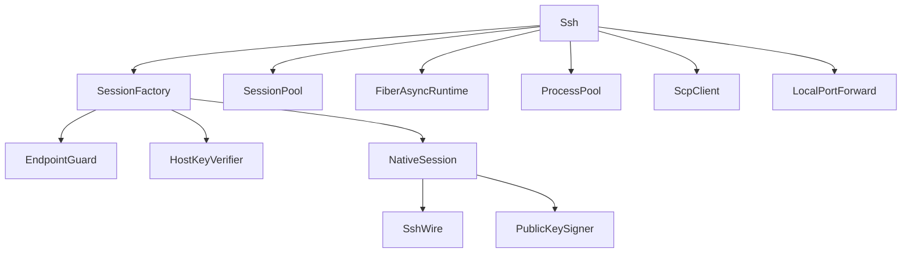

**ru** · [en](../en/Architecture.md) · [de](../de/Architecture.md) · [fr](../fr/Architecture.md) · [es](../es/Architecture.md) · [it](../it/Architecture.md)

# Architecture

Слои Deptrac:

1. **Contract** — публичные интерфейсы
2. **Exception** — иерархия `SshException`
3. **Core** — Client, Session, Wire, Auth, Security, Async, Pool, Process, Scp, Forward
4. **Tests** — PHPUnit + TCP MockSshPeer

Подробности — корневой [ARCHITECTURE.md](https://github.com/admin-cloud-castle/ssh/blob/main/ARCHITECTURE.md).

**ru** · [en](../en/Architecture.md) · [de](../de/Architecture.md) · [fr](../fr/Architecture.md) · [es](../es/Architecture.md) · [it](../it/Architecture.md)
