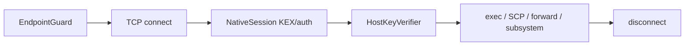

**ru** · [en](../en/Home.md) · [de](../de/Home.md) · [fr](../fr/Home.md) · [es](../es/Home.md) · [it](../it/Home.md)

  

# cloud-castle/ssh

Нативный SSH-2 клиент на PHP 8.1+ без Composer runtime-зависимостей:
password/publickey, exec, SCP, port-forward, `openSubsystem()`, Fibers-async,
пул сессий, мультипроцесс, host-key verify и SSRF-guard.

## Навигация

- [Installation](Installation.md)
- [Quick-start](Quick-start.md)
- [Configuration](Configuration.md)
- [Examples](Examples.md)
- [Architecture](Architecture.md)
- [Comparison](Comparison.md) (≥5 аналогов, таблицы с 🏆 Победитель)
- [Testing](Testing.md)
- [FAQ](FAQ.md)
- [Contributing](Contributing.md)

## Жизненный цикл сессии

**ru** · [en](../en/Home.md) · [de](../de/Home.md) · [fr](../fr/Home.md) · [es](../es/Home.md) · [it](../it/Home.md)
